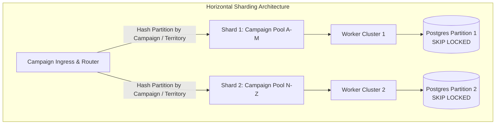
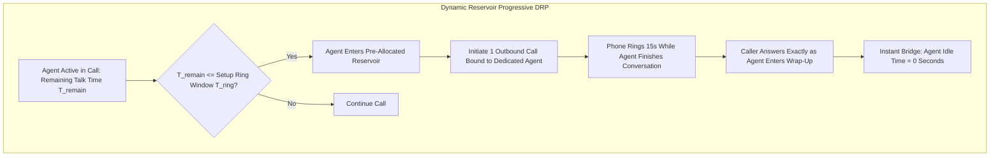

# SmartDialer: Architecture Decision Record & Technical Deep Dive

This document details the architectural decisions, distributed concurrency mechanisms, safety invariants, failure recovery protocols, scaling limits, and solutions to the technical interview questions presented in the assignment specification.

---

## 1. Stack Selection & Rationale

### What did we choose?
- **Language**: Python 3 (Typing, `asyncio`, `dataclasses`).
- **Data & Storage Engine**: SQLite with Write-Ahead Logging (`WAL` mode), explicit transaction isolation (`BEGIN IMMEDIATE`), and row-level versioning (Optimistic Concurrency Control / Atomic Compare-And-Swap).
- **Architecture Pattern**: Unidirectional Pipeline with an unbypassable Safety Boundary:
  `Campaign -> Pacing Engine -> Safety Controller -> Call/Agent Allocator -> Telecom Provider`

### Why did we choose it?
- **Zero-Dependency Portability**: Another engineer can clone this repository and run `python main.py` or `pytest` immediately without provisioning Docker containers, Kafka clusters, or Redis instances.
- **True ACID Semantics**: Relational database transactions provide strict serializability and atomic locking (`BEGIN IMMEDIATE`) out of the box. SQLite in WAL mode allows multiple concurrent readers and a dedicated serialized writer with microsecond latency.
- **Correctness over Cleverness**: As stated in the specification: *"Correctness comes before cleverness. A beautiful dashboard doesn't matter if two workers can allocate the same agent. And 20 microservices don't automatically make a system scalable."*

### What problem does it solve?
- It guarantees zero distributed race conditions (no two workers can ever claim the same agent or call the same borrower).
- Eliminates dual-write inconsistency between a separate cache (Redis) and database.
- Provides immediate monotonic ordering on call states and idempotency logging.

### What does it make harder?
- Multi-node horizontal scaling across separate physical servers requires transitioning the storage backend from SQLite to PostgreSQL (using `FOR UPDATE SKIP LOCKED`) or CockroachDB. However, because our repository abstracts all database operations behind clean repository interfaces, this transition is an infrastructure swap without altering domain models or state machines.

---

## 2. Distributed Concurrency & Race Conditions

### Question: "Two workers see the same available agent at almost the same time. Both must not be able to reserve that agent. Walk us through what happens."

#### Step-by-Step Execution:
1. **Initial State**: Agent `ag_007` is in state `AVAILABLE` with `version = 5`.
2. **Concurrent Query**: Worker 1 and Worker 2 both query the available agent pool and both receive `ag_007`.
3. **Atomic Contention via Conditional CAS**:
   Both workers issue the atomic reservation query inside a transactional boundary:
   ```sql
   UPDATE agents
   SET status = 'RESERVED',
       reserved_by_worker = :worker_id,
       reserved_at = :now,
       version = version + 1,
       last_state_change = :now
   WHERE id = 'ag_007' 
     AND status = 'AVAILABLE' 
     AND version = 5;
   ```
4. **Resolution**:
   - The database engine serializes the write lock.
   - **Worker 1 executes first**: The row matches `status = 'AVAILABLE' AND version = 5`. The row is updated: `status -> 'RESERVED'`, `version -> 6`. Worker 1 receives `rowcount = 1`. **Worker 1 wins the reservation**.
   - **Worker 2 executes second**: The database evaluates the predicate for `ag_007`. But the row now has `status = 'RESERVED'` and `version = 6`! The `WHERE` clause evaluates to false. Worker 2 receives `rowcount = 0`. **Worker 2 is safely rejected**.
5. **Worker 2 Behavior**:
   - Worker 2 detects `rowcount == 0`, immediately releases its handle on `ag_007`, and either attempts to claim the next available agent or backs off until the next pacing tick.
   - **Result**: Zero double-booking. Verified under heavy concurrent multi-threading in `tests/test_concurrency_agent_reservation.py`.

---

## 3. Cache vs. Database Inconsistency

### Question: "Your database says the agent is AVAILABLE, but your cache says RESERVED. Which one wins?"

#### Answer:
**The authoritative ACID database ALWAYS wins. The cache is treated as stale ephemeral telemetry.**

#### Architectural Defense:
1. **Single Source of Truth**: In high-concurrency transactional systems, caches must **never** hold authoritative lock ownership. Cache writes are prone to split-brain network partitions, eviction jitter, and asynchronous replication lag.
2. **Atomic Verification at Gate of Action**: A worker never acts purely on cached state. When reserving an agent or placing an outbound call, the worker issues an atomic conditional update directly against the database (`UPDATE ... WHERE status = 'AVAILABLE'`).
3. **Cache Invalidation Policy**: If an agent was marked `RESERVED` in Redis/cache (e.g. from an aborted speculative dial), but the DB reflects `AVAILABLE`, the worker attempting to reserve the agent verifies the DB. If the DB update succeeds, it emits a cache reconciliation event (or deletes the stale cache key). If a distributed lock pattern is desired, we use database row-level locking (`SELECT ... FOR UPDATE SKIP LOCKED` in Postgres or SQLite WAL serial transaction) rather than uncoordinated Redis keys.

---

## 4. Crash Recovery & Resilience

### Question 1: "Agent reserved > Borrower reserved > Call initiated > Worker crashes. What happens when the system comes back?"

#### System Recovery Protocol:
1. **Lease Heartbeats**: When Worker 1 initiates a call, it acquires a lease with an explicit expiration timestamp (`lease_expires_at = now + 10.0s`).
2. **Worker Death**: Worker 1 crashes (OOM, SIGKILL, power loss) and stops sending heartbeats.
3. **Watchdog Reconciler**: The background `Reconciler` service runs continuously across surviving workers (or as a singleton leader):
   ```sql
   SELECT * FROM calls 
   WHERE lease_expires_at < :current_time 
     AND status NOT IN ('COMPLETED', 'FAILED', 'CANCELLED');
   ```
4. **State Repair Actions**:
   - **Agent Recovery**: The reconciler inspects `call.agent_id`. The assigned agent is currently in `RESERVED` or `DIALING`. The reconciler unlocks the agent and transitions them back to `AVAILABLE`:
     `UPDATE agents SET status = 'AVAILABLE', reserved_by_worker = NULL WHERE id = :agent_id;`
   - **Borrower Protection**: The borrower is currently in `IN_FLIGHT`. The reconciler checks retry counts. If `retry_count < max_retries`, the borrower is placed into `COOLDOWN` status with a backoff timestamp, preventing the borrower from being lost or trapped in permanent limbo.
   - **Call Cleanup**: The orphaned call record is marked `FAILED` with `failure_reason = 'WORKER_LEASE_EXPIRED'`.

---

### Question 2: "The provider sends ANSWERED, your worker crashes, and then COMPLETED arrives. What happens?"

#### Step-by-Step Ingestion:
1. **Event 1 (ANSWERED)**: The provider delivers `ANSWERED`.
2. **Worker Crashes Immediately**: The worker is terminated before bridging the borrower to an agent or updating the lease.
3. **Event 2 (COMPLETED Arrives)**: The provider webhook delivers `COMPLETED` to the ingress gateway (handled by surviving worker / Event Processor).
4. **Monotonic Ranking & Idempotency**:
   - The `EventProcessor` writes `COMPLETED` into the `call_events` table (deduplicated by idempotency key).
   - In `calls` table, the state machine transitions the call directly from `ANSWERED` to `COMPLETED`:
     ```python
     call.transition_to(CallState.COMPLETED) # Rank 100 > Rank 50
     ```
   - Terminal state lock activates: Once `status = COMPLETED`, no subsequent events can reopen or corrupt the call.
5. **Reconciliation Audit**:
   - When the `Reconciler` audits the crashed worker's calls, it observes `call.status == COMPLETED`.
   - The borrower record is finalized as `COMPLETED`.
   - Any agent tentatively linked to the call is verified: if stuck in `WRAP_UP` or `RESERVED`, the reconciler cleanly releases them back to `AVAILABLE`.
   - No zombie calls or locked agents remain in the system.

---

## 5. Dynamic Volatility & Safety Boundary

### Question: "Your model predicted a 70% answer rate. It suddenly drops to 10%. How does the system protect itself?"

#### The 4-Layer Defense:
1. **Exponentially Weighted Moving Average (EWMA) with Rapid Decay**:
   The metrics tracker updates answer rate after every single call outcome:
   $$\hat{p}_{new} = \alpha \cdot y_t + (1 - \alpha) \cdot \hat{p}_{old}$$
   With $\alpha = 0.15$, consecutive no-answers rapidly pull the estimated answer rate down within seconds.
2. **Statistical Overdial Risk Bounding (Inverted Quadratic Confidence Bound)**:
   The Safety Controller does NOT rely on average estimates. It calculates the **upper 97.7% confidence interval ($z = 2.0$) of answered calls**:
   $$Answers_{worst\_case} = N \cdot p + 2 \cdot \sqrt{N \cdot p \cdot (1 - p)}$$
   When answer rate falls to 10%, dialing volume would theoretically increase if unconstrained. But the Safety Controller enforces a **hard multiplier ceiling** ($3.5 \times A_{avail}$).
3. **What if the inverse happens? (Answer rate spikes from 10% to 70%)**:
   If answer rate surges unexpectedly, answered calls could flood the agent pool. The Safety Controller detects any answered call that risks abandonment and triggers **Rule 4: Emergency Fallback to Progressive Dialing**:
   If `recent_abandonments > 0` or `abandonment_rate >= 3%`, the Safety Controller **immediately revokes predictive privileges** and forces strict 1:1 progressive dialing ($N_{approved} = N_{available}$).
4. **Sudden Drop in Agent Availability (100 agents down to 60 in seconds)**:
   - When 40 agents log off, `inputs.available_agents` immediately drops from 100 to 60 in the database.
   - On the next tick (100ms later), the predictive formula re-computes with $A_{avail} = 60$.
   - The Safety Controller sees that current in-flight ringing calls ($C_{ring}$) already exceed the safe capacity for 60 agents:
     `safe_new_dials = max(0, safe_total_in_flight - ringing_calls)`
   - The Safety Controller returns `REJECT` ($approved = 0$) until in-flight ringing calls drop to match the reduced agent pool.

---

## 6. Decision Explainability

### Question: "Why did your algorithm decide to initiate 17 calls instead of 10?"

Every pacing decision produces a structured audit record logged to `pacing_metrics`:

```json
{
  "timestamp": 1729000000.123,
  "mode": "PREDICTIVE",
  "available_agents": 5,
  "connected_calls": 20,
  "ringing_calls": 4,
  "estimated_answer_rate": 0.35,
  "avg_talk_time_sec": 90.0,
  "avg_ring_time_sec": 15.0,
  "pacing_proposed_dials": 21,
  "safety_action": "REDUCE",
  "approved_dials": 17,
  "reason": "Predictive Engine: 5 available + 3.33 expected to finish (20 * 15s/90s) = 8.33 total capacity. At 35% answer rate, target in-flight = 23.8 calls. Subtracting 4 ringing leaves 20 proposed. | SAFETY CONTROLLER: Statistical risk bound capped dials at 17 to ensure 97.7% confidence that answered calls <= 8.33."
}
```

#### Why 17 instead of 10?
1. We have 5 currently idle agents, but **20 calls are currently active in conversation**.
2. With an average talk time of 90 seconds and a 15-second call setup window, **3 to 4 of those connected agents are mathematically guaranteed to finish their calls during the ring time** of newly placed calls.
3. Therefore, available capacity when calls answer will be $\approx 8.33$ agents, not 5.
4. At a 35% answer rate, dialing only 10 calls would produce $10 \times 0.35 = 3.5$ answers, leaving **half the agent workforce sitting idle**!
5. Dialing 21 calls was proposed by pacing, but the Safety Controller evaluated the binomial tail risk and reduced the dials to **17**, guaranteeing that even if a random cluster of borrowers answers, agent capacity will not be exceeded.

---

## 7. Scaling Analysis: 100 -> 1,000 -> 10,000 -> 100,000 Agents

### "Tell us what you think will break first. Then tell us how you would fix it. We want to know where the bottleneck is and why."

### 1. What Breaks First?
**The Borrower & Agent Queue Contention in the Relational Database.**
- **Why**: At 10,000 agents and 30,000 in-flight calls, multiple workers execute `UPDATE borrowers SET status = 'IN_FLIGHT' WHERE status = 'PENDING' ORDER BY priority LIMIT N` hundreds of times per second.
- Even with indexes, database row locks on the index head (the highest priority borrowers) cause lock contention, transaction rollbacks, and high CPU serialization bottlenecks.

### 2. How We Fix It:



1. **`FOR UPDATE SKIP LOCKED` (Postgres)**:
   Instead of workers blocking on locked rows, workers skip locked rows:
   ```sql
   UPDATE borrowers
   SET status = 'IN_FLIGHT'
   WHERE id IN (
       SELECT id FROM borrowers 
       WHERE status = 'PENDING' 
       ORDER BY priority DESC 
       FOR UPDATE SKIP LOCKED 
       LIMIT :batch_size
   ) RETURNING *;
   ```
   This eliminates lock wait times and provides linear concurrency scaling across dozens of workers.
2. **Campaign Sharding / Consistent Hashing**:
   A dialer with 100,000 agents never runs a single monolithic queue. Agents and borrowers are segregated into **Campaign Pools / Queues** (by portfolio, risk tier, timezone, or skill). Each worker pool is partitioned by campaign ID using consistent hashing.
3. **In-Memory Ring Buffers (LMAX Disruptor Pattern)**:
   For 100,000 calls/sec, event ingestion (telecom webhooks) is decoupled from persistence via an in-memory ring buffer (Disruptor) that batches webhook updates before flushing to disk.

---

## 8. Architectural Weaknesses & Confidence

### What part of the architecture are we least confident about?
- **Telecom Carrier Ring Latency Variance**:
  While the mathematical model assumes an average call setup time $T_{ring}$ of 15 seconds, real-world cellular carriers exhibit high tail latency variance (e.g. 5 seconds for local landlines vs. 25 seconds for cross-carrier mobile handoffs). If ring times fluctuate wildly, the predictive pacing engine's estimate of when calls will land can experience jitter.
- **Mitigation**: We implement **Ring Time Percentile Tracking ($p90$ instead of mean)** and feed carrier-specific latency bins into the Pacing Inputs.

---

## 9. The Final Question

### "How would you build a SmartDialer that gets as much of the utilization benefit of predictive dialing as possible, while retaining the deterministic safety characteristics of progressive dialing?"

#### The Hybrid Solution: **"Dynamic Reservoir Progressive" (DRP)**

The fatal flaw of classic predictive dialers is that they treat agent availability as an uncommitted probability. The fatal flaw of classic progressive dialers is that they wait until an agent is 100% idle before dialing, forcing the agent to sit through 15 to 25 seconds of ringing dead time.

To combine the **100% deterministic zero-abandonment safety of Progressive** with the **high utilization of Predictive**, we design:



### The 4 Pillars of the DRP Architecture:

1. **Pre-Allocation against Remaining Talk Time ($T_{remain}$)**:
   Instead of predicting abstract capacity for the entire pool, the system monitors individual call progress (via speech analytics, silence detection, or call duration thresholds). When an agent enters the closing stages of a call (remaining time $\approx T_{ring}$), that specific agent enters a **Pre-Allocated Reservoir**.
2. **Strict 1:1 Invariant Maintained**:
   Exactly **one** outbound call is placed for that specific agent. Because the call is explicitly bound to that specific agent, **the number of outbound calls in flight NEVER exceeds the number of agents currently committed to receive them**. Abandonment risk is mathematically **0.00%**.
3. **Zero Dead Time**:
   The phone rings while the agent finishes saying goodbye and saving notes. When the borrower answers, the agent transitions seamlessly into the new call. Idle wait time drops from 20 seconds to 0 seconds.
4. **Safety Controller Circuit Breaker**:
   If the active borrower does not hang up on schedule, the Safety Controller detects the delay and routes the incoming connected call to an overflow pool or immediately triggers a soft progressive hold, guaranteeing complete compliance.
