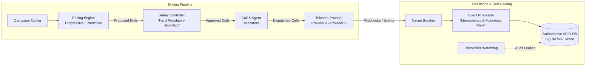
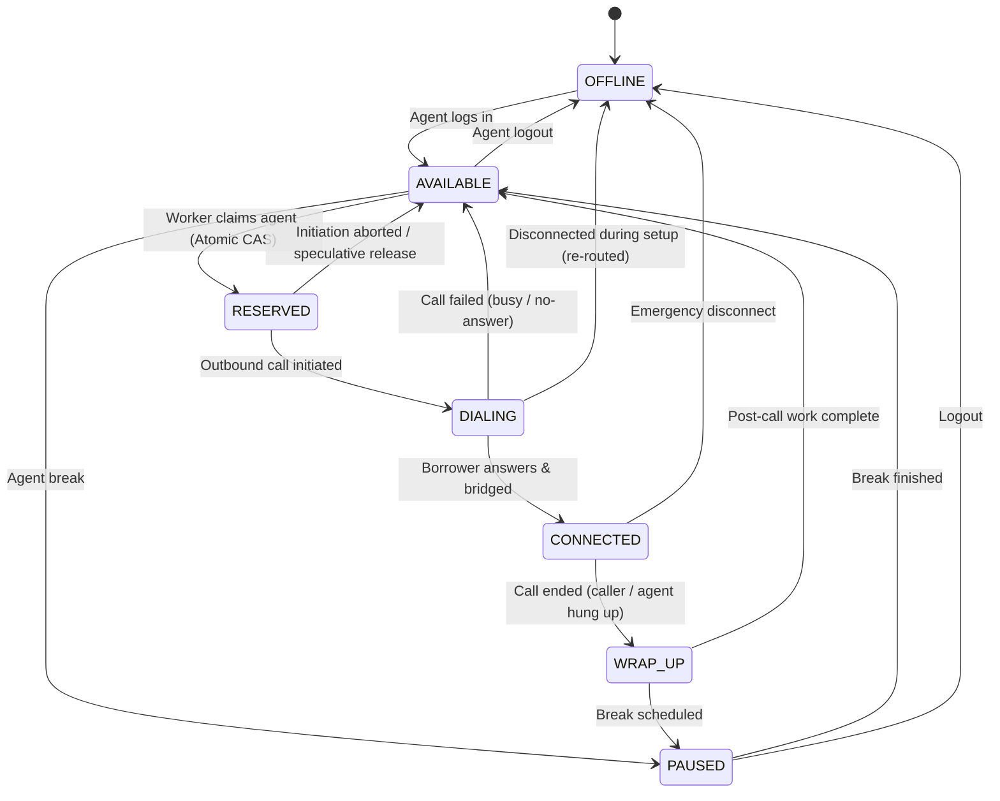
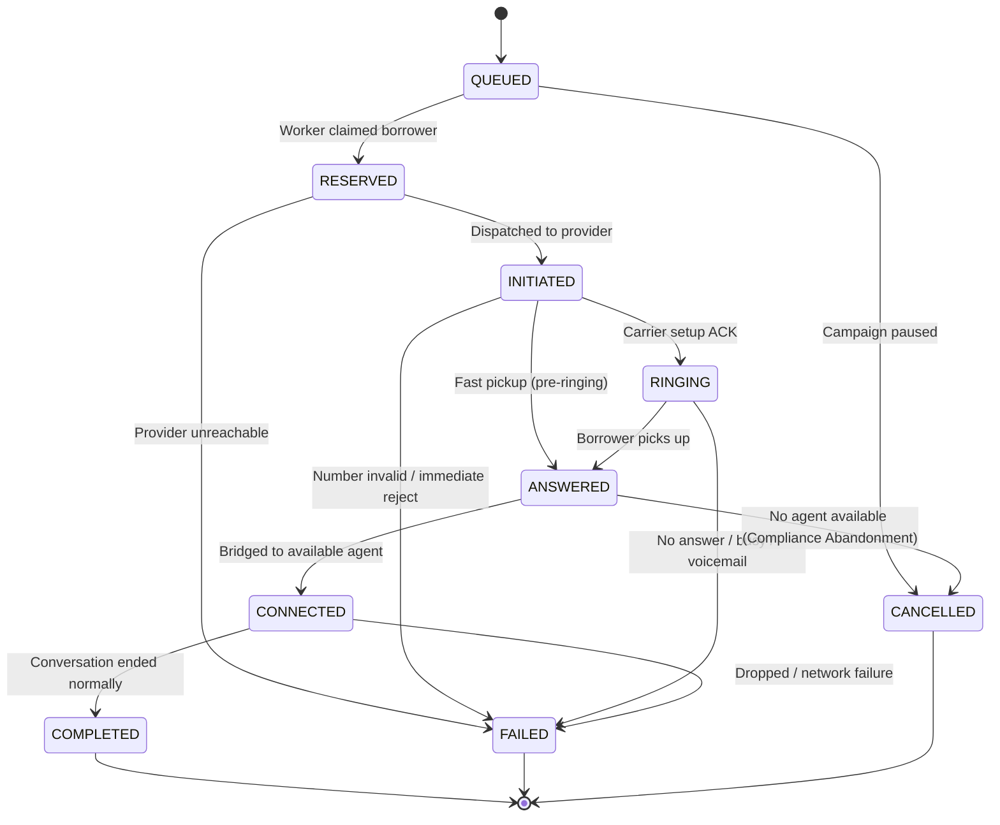

# SmartDialer: High-Concurrency Progressive & Predictive Dialing Engine

A production-grade, fault-tolerant Collections SmartDialer featuring both **Progressive** (1:1 deterministic) and **Predictive** dialing modes, backed by an **unbypassable Safety Controller**, atomic concurrency guards, and self-healing crash reconciliation.

---

## 1. System Architecture

The dialer implements a strict unidirectional pipeline where **predictive pacing logic can NEVER directly place a call**. The Safety Controller operates as a regulatory gatekeeper to prevent compliance violations (TCPA call abandonment limits).



---

## 2. State Machines

### 2.1 Agent State Machine



### 2.2 Call State Machine & Monotonic Ordering

Each state has a strictly monotonic rank to prevent out-of-order telecom webhooks from corrupting call state:



> **Out-of-Order Guard**: Once a call reaches a terminal state (`COMPLETED`, `FAILED`, `CANCELLED`), any subsequent late-arriving events (such as `RINGING` or `ANSWERED`) are safely rejected as regressive events and cannot alter the call state.

---

## 3. Key Components

| Component | Path | Responsibility |
|---|---|---|
| **Pacing Engines** | `smartdialer/pacing/` | Calculates outbound dials. Progressive enforces 1:1; Predictive uses Little's Law / Erlang expected completions + dynamic EWMA answer rate. Provides complete human-readable explainability. |
| **Safety Controller** | `smartdialer/safety/` | Hard boundary. Evaluates statistical overdial risk ($z \ge 2.0$), agent capacity floor, abandonment limits ($< 3\%$), and provider circuit breaker health. Can `APPROVE`, `REDUCE`, `REJECT`, or `FALLBACK_PROGRESSIVE`. |
| **Storage & Concurrency** | `smartdialer/storage/` | SQLite in WAL mode with ACID transactions (`BEGIN IMMEDIATE`) and optimistic locking. Guarantees zero agent double-booking across workers. |
| **Allocators** | `smartdialer/allocation/` | `AgentAllocator` (fair longest-idle reservation & disappearance re-routing); `CallAllocator` (borrower priority queue, deduplication, retry policy, cooldowns). |
| **Telecom Providers** | `smartdialer/providers/` | `ProviderA` (fast, reliable 99.5%); `ProviderB` (slow, timeouts, duplicate events, out-of-order events); `CircuitBreaker` (CLOSED / OPEN / HALF-OPEN). |
| **Event Processor** | `smartdialer/engine/event_processor.py` | Ingests webhooks with idempotency keys and monotonic rank guards. Handles duplicate events and out-of-order arrivals. |
| **Reconciler** | `smartdialer/engine/reconciler.py` | Crash recovery watchdog. Reclaims orphaned agents and expired worker leases (`Agent reserved > Borrower reserved > Call initiated > Worker crashes`). |
| **Simulator** | `smartdialer/simulation/` | Discrete-event simulator executing Scenarios A, B, C, D and failure injections with rich ASCII terminal reporting. |
| **Load Test** | `smartdialer/load_test/` | Multi-worker concurrent load testing benchmarking throughput and asserting zero race conditions. |

---

## 4. Setup & Running Instructions

### Prerequisites
- Python 3.10+ (tested on Python 3.14).
- Standard library only for runtime (zero external dependencies required!).
- `pytest` for test execution.

### Installation
```powershell
# Clone or navigate to the project directory
cd c:\Users\USER\Downloads\Project
```

### Running Tests
Execute the comprehensive 24-test suite covering state machines, concurrency, idempotency, out-of-order events, circuit breakers, and crash recovery:
```powershell
python -m pytest -v
```

### Running Simulations

#### Run Page 6 Core Scenarios:
```powershell
# Scenario A: 20% Answer Rate, 120s Talk Time
python main.py simulate --scenario A

# Scenario B: 50% Answer Rate, 90s Talk Time
python main.py simulate --scenario B

# Scenario C: 70% Answer Rate, 180s Talk Time (Shows Safety Controller throttling)
python main.py simulate --scenario C

# Scenario D: Volatile Environment (Dynamic Answer Rate 20% -> 65% -> 15% shock & Talk Time change)
python main.py simulate --scenario D
```

#### Run Failure Scenarios (Page 5 & 6):
```powershell
# Failure Case 1: Worker crashes during call setup -> Reconciler recovers agent and call
python main.py simulate --scenario FAIL_WORKER_CRASH

# Failure Case 2: Telecom provider outage -> Circuit breaker trips -> Safety fallback to Progressive
python main.py simulate --scenario FAIL_PROVIDER_OUTAGE

# Failure Case 3: 40 agents abruptly disconnect -> Instant dialing clamp
python main.py simulate --scenario FAIL_AGENT_DROP

# Failure Cases 4 & 5: Duplicate and out-of-order events from Provider B
python main.py simulate --scenario FAIL_CHAOS_EVENTS
```
### Running Multi-Worker Load Test
Benchmark high-concurrency race condition resistance across multiple concurrent dialer workers:
```powershell
python main.py load-test --workers 8 --agents 100 --borrowers 1000
```
